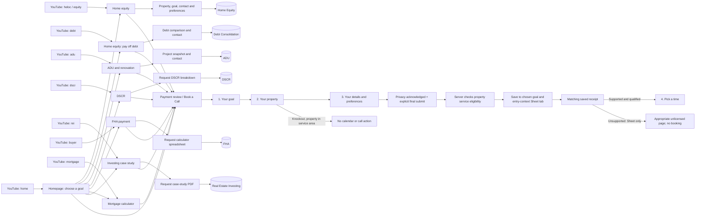
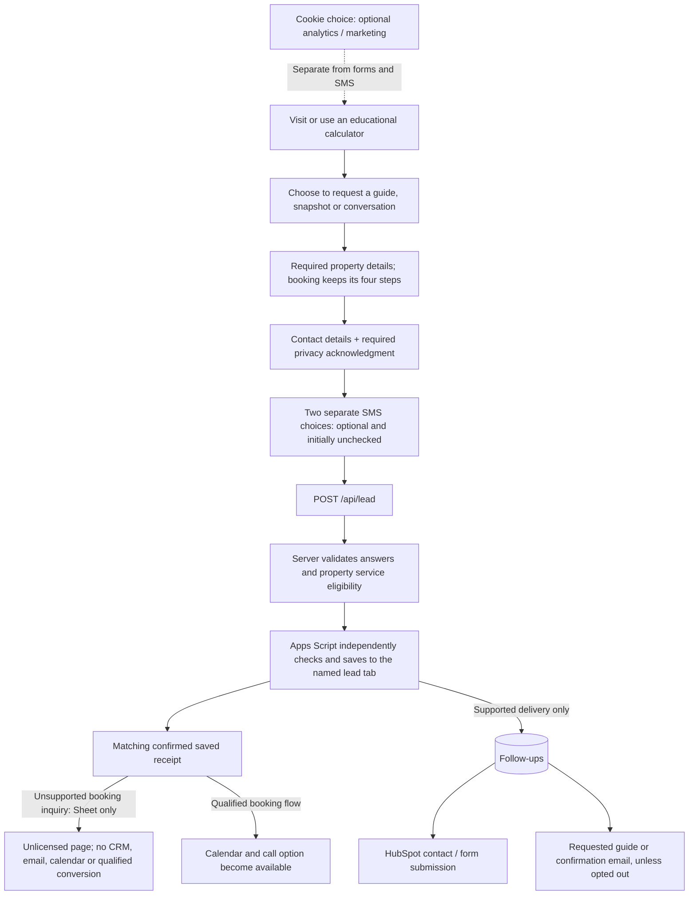

# Consumer journey: YouTube to a saved request

The YouTube short links keep campaign parameters and click IDs. The base link is for a description; the same bucket with `-c` is for a pinned comment. Both reach the same page. By default they carry `utm_source=youtube`, `utm_medium=social` and a bucket-specific campaign, with different `utm_content` values.

## Page and request map

| YouTube bucket | Landing page | Main request | Sheet tab |
| --- | --- | --- | --- |
| `/yt/heloc`, `/yt/equity` | `/home-equity/` | Equity snapshot, `home-equity-calculator` | **Home Equity** |
| `/yt/debt` | `/home-equity/?goal=payoff` | Debt-payment comparison, `debt-savings-calculator` | **Debt Consolidation** |
| `/yt/adu` | `/adu/` | Project snapshot, `adu-calculator` | **ADU** |
| `/yt/dscr` | `/dscr/` | DSCR breakdown, `dscr-magnet` | **DSCR** |
| `/yt/rei` | `/realestateinvesting/` | Case-study PDF, `rei-magnet` | **Real Estate Investing** |
| `/yt/buyer` | `/fha/` | Calculator spreadsheet, `fha-magnet` | **FHA** |
| `/yt/mortgage` | `/mortgage-calculator/` | Screened payment review / booking | **Mortgage Review** when the chosen goal is buying/refinancing a home; otherwise the chosen goal's tab below |
| `/yt/home` | `/` | Choose a page or open screened booking | The selected page's form tab, or the booking tab below |

Every bucket also has a `-c` version. The old debt URL redirects to the payoff path. The historical **Debt Consolidation** Sheet name remains so existing records and mappings stay intact; it is not a separate public product page.

## Book a Call: the selected goal controls the tab

The booking form is `booking-prequal`. Its entry page is retained separately; visiting a particular page does not force every booking into that page's tab.

The four steps remain **Your goal → Your property → Your details → Pick a time**, with their existing field order. Property type and mortgage-history knockouts still decline a property inside the service area; outside it, the inquiry continues and is recorded Sheet-only whatever those answers are. Choosing a property state does not redirect or save a request. State screening happens only on the explicit final submit after the required privacy acknowledgment, name, email, phone and property details are complete; checking the privacy box alone does not submit.

A supported, qualified inquiry receives the calendar after a matching saved receipt. A valid unsupported inquiry is recorded in the same goal-based Sheet category, including property state, property use, **Licensed?**, service eligibility and its Sheet-only disposition; only after confirmation does the visitor reach the existing primary-home or investment-property unlicensed page, which then shows a note that the inquiry is recorded. It creates no HubSpot, requested-email, guide or CallRail form-sync job, calendar access or qualified lead conversion. A save failure stays in the flow with the same inquiry ID for safe retry.

**Licensing and service eligibility are separate.** Primary/second homes use Darren's eight licensed states. Investment properties retain the broader current DSCR policy: a Colorado investment property is supported even though Colorado is not one of those eight states; a Colorado primary home and a New York investment property are Sheet-only. Both the proxy and Sheet writer compute this decision rather than trusting a posted result.

| Goal selected in booking | Entry context | Sheet tab |
| --- | --- | --- |
| Access home equity | ADU page / ADU contact | **ADU** |
| Access home equity | Any other page | **Home Equity** |
| Investment property / DSCR | Any page | **DSCR** |
| Buy/refinance a home | FHA page | **FHA** |
| Buy/refinance a home | Mortgage calculator / payment review | **Mortgage Review** |
| Buy/refinance a home | Other pages | **Home Purchase & Refinance** |
| Commercial property | Any page | **Commercial** |
| Not sure / needs guidance | Any page | **Needs Guidance** |

A booking for debt payoff uses the home-equity goal and therefore the **Home Equity** tab, unless entered from ADU. The **Debt Consolidation** tab is for the detailed debt-comparison form.

## What happens at opt-in

- Visiting a page or moving an educational slider does **not** create a lead row.
- Required privacy acknowledgment is distinct from optional SMS and optional cookie tracking. Forms and calculators work with optional cookies rejected; current-page attribution can remain in memory.
- Unsupported booking inquiries are recorded for state-demand reporting only, after voluntary final submission. They are not qualified form conversions and do not enter the delivery/retry queue. The new Sheet-only path applies to the shared booking flow; calculator and guide screening rules remain in place.
- A guide request is saved before its asynchronous email or HubSpot job runs. An email opt-out remains effective even when a new request is saved.
- **Follow-ups** is the delivery/retry queue. **Debug** holds diagnostics. Neither is a consumer opt-in destination.
- The ten consumer lead buckets shown here use Home Equity, Debt Consolidation, ADU, DSCR, FHA, Real Estate Investing, Mortgage Review, Home Purchase & Refinance, Commercial and Needs Guidance. Together with Follow-ups and Debug, these explain twelve tab roles in the journey. Reserved legacy schemas are not additional public funnels.

Implementation references: `netlify/functions/youtube-redirect.mts` (`SHORTLINKS`), `google-apps-script.js` (`SOURCE_SCHEMAS`, `targetedSource`, `bookingBucket`), the page's form ID, and `public/booking-chooser.js`.
